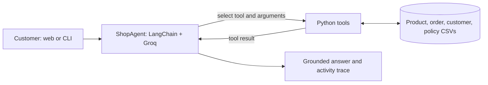

# CircuitCart — Agentic AI e-Commerce Assistant

CircuitCart is a Python web application and command-line demo of an agentic e-commerce assistant. It uses a Groq-hosted language model through LangChain and a set of Python tools to answer product-discovery and customer-service questions from a local catalogue and simulated store data.

> This is a university project, not a live retailer. Catalogue prices are research snapshots, ratings and stock are demo values, and orders, customers, and return policies are synthetic. The store uses a configurable simulated date (`SHOP_TODAY`, default `2026-11-01`) for repeatable return-policy examples.

## What it can do

- Search and filter the 300-product catalogue by natural-language requirements, category, brand, price, rating, availability, and specifications.
- Retrieve product details and compare products in the same category.
- Answer customer-scoped questions about orders, delivery estimates, payment status, return policies, return eligibility, and refunds using the supplied demo data.
- Create a simulated return request when the order meets the policy rules.
- Sign users up and in using email OTP. OTP delivery can use SMTP; a development mode is available for local setup.
- Show the assistant's tool activity so users can see when it retrieves or acts on store data.

The assistant cannot place real orders, accept payments, contact couriers, or issue real refunds. It declines unrelated requests outside the store-assistant scope. Facts missing from the CSVs are reported as unavailable instead of guessed.

## How the agent works



For each request, the model decides whether a tool is needed, selects a tool and supplies arguments. The Python function runs against the project data; its result is returned to the model to form the answer. Order tools receive the authenticated customer's ID from the app, not from the model's guess.

### Available tools

`search_products`, `get_product_details`, `compare_products`, `list_categories`, `list_my_orders`, `get_order_status`, `get_return_policy`, `check_return_eligibility`, `get_refund_details`, and `initiate_return`.

## Quick start (Windows PowerShell)

Requirements: Python 3.10 or later, a Groq API key, and network access to the Groq API. SMTP is optional for development; use it for real email OTP delivery.

```powershell
git clone https://github.com/gsv3245-cpu/E-Commerce_Assistant.git
cd E-Commerce_Assistant
py -m venv .venv
.venv\Scripts\Activate.ps1
python -m pip install -r requirements.txt
Copy-Item data\.env.example data\.env
Copy-Item data\customer_accounts.example.csv data\customer_accounts.csv
```

Edit `data/.env` and set `GROQ_API_KEY`. Keep this file private. Never commit it or paste its contents into an issue or chat.

Run the web dashboard:

```powershell
python server.py
```

Open [http://127.0.0.1:5000/login](http://127.0.0.1:5000/login). To use another local port, set `$env:PORT=5001` before starting the server.

Run the command-line assistant:

```powershell
python cli.py --customer C0001
```

Use `/customers` in the CLI to list the synthetic customer IDs; use `exit` to quit.

## Configuration and login

The safe starter settings are in [`data/.env.example`](data/.env.example). Important variables:

| Variable | Purpose |
|---|---|
| `GROQ_API_KEY` | Required API key for Groq model calls. |
| `GROQ_MODEL` | Model name; defaults to `openai/gpt-oss-20b`. |
| `FLASK_SECRET_KEY` | Stable random key used to sign browser sessions. Set a long, private value. |
| `OTP_DEVELOPMENT_MODE` | `true` enables local development OTP behavior. Use `false` with valid SMTP settings for emailed codes. |
| `SMTP_HOST`, `SMTP_PORT`, `SMTP_USERNAME`, `SMTP_PASSWORD`, `SMTP_FROM` | Optional SMTP sender settings. For Gmail, use an App Password with 2-Step Verification enabled. |
| `ADMIN_LOGIN_EMAIL`, `ADMIN_LOGIN_OTP` | Optional reusable local/admin code for one already-registered email. Keep both private and unset unless needed. This is a development convenience, not a production authentication design. |
| `DATABASE_URL` | Optional PostgreSQL connection for persistent accounts and mutable app state. When unset, the app uses local CSV and in-process storage. |
| `SHOP_TODAY` | Simulated store date (`YYYY-MM-DD`) used by return-policy calculations. |

The app's email-to-customer mapping is `data/customer_accounts.csv`. The repository contains a header-only template, not real email addresses. To associate an email with an existing synthetic customer, add a row such as `you@example.com,C0001`; the customer ID must exist in `data/customers.csv`. New signups are added after email verification. Do not commit your populated mapping file.

With development OTP mode, the app exposes a locally usable code for development. With SMTP configured and development mode off, sign-in/signup codes are delivered by email. Signup requires first name, last name, and email; the account is created only after code verification. The optional reusable admin code only works for the configured, already-registered email.

## Project layout

| Path | Purpose |
|---|---|
| `server.py` | Flask app, authentication endpoints, and dashboard API. |
| `agent.py`, `llm.py` | LangChain agent loop, tool-calling model configuration, and trace data. |
| `tools.py` | Catalogue, order, delivery, return, and refund operations. |
| `login.html`, `dashboard.html`, `static/` | Browser login and shop dashboard UI. |
| `cli.py` | Terminal assistant. |
| `config.py`, `mailer.py`, `persistence.py` | Configuration, SMTP OTP delivery, and optional PostgreSQL persistence. |
| `data/` | Product catalogue, synthetic customers and orders, policy data, and data dictionary. |
| `evaluation/` | Evaluation cases, scoring, and the evaluation runner. |
| `tests/` | Automated unit and integration tests. |
| `ADL-Project-Group-2.pdf` | Assignment brief supplied with the project. |

## Catalogue and data relationships

`data/products.csv` contains 300 distinct India-market product listings across 24 categories and includes the assignment fields: product ID, product name, category, price, brand, rating, stock, and specifications. Listing identity/specifications and research links are curated; price is a dated snapshot; stock and rating are synthetic.

`data/orders.csv` contains simulated orders. `orders.product_id` links to `products.product_id`, and `orders.customer_id` links to `customers.customer_id`. Return policies join to products by category. [`data/README.md`](data/README.md) documents every CSV, its columns, row counts, and join keys. The CSVs can be opened in Excel.

The order data does not include actual delivery dates, quantity, line-item price, payment method, or actual refund amount/timing. The demo policies are synthetic, and business-day calculations do not account for public holidays. The local CSV files are the source data; the optional PostgreSQL database stores customer identities and mutable app state, not the catalogue.

## Evaluation

The project includes **62 evaluation cases**: 27 product-discovery cases and 35 customer-service cases, exceeding the assignment minimum of 20 in each category.

Run the no-LLM oracle self-check:

```powershell
python -m evaluation.run_evaluation --oracle
```

Run cases using the configured Groq model:

```powershell
python -m evaluation.run_evaluation
```

Optional subsets:

```powershell
python -m evaluation.run_evaluation --only discovery
python -m evaluation.run_evaluation --only service
python -m evaluation.run_evaluation --ids D01,S05
```

Evaluation outputs are written under `results/` and are local/generated files. Metrics cover tool selection, constraint/policy compliance, and task completion. Some response-text checks are keyword-based, so inspect failure notes when interpreting model results. The oracle self-check tests tool/evaluation wiring without an LLM; it does not measure Groq response quality.

## Tests

```powershell
python -m unittest discover -s tests -v
```

The tests cover tools, evaluation metrics, email formatting, and server behavior. No API key is required for the test suite.

## Troubleshooting

| Symptom | Check |
|---|---|
| Groq is not configured | Set `GROQ_API_KEY` in `data/.env` and restart the app. |
| Customer accounts unavailable | Copy `data/customer_accounts.example.csv` to `data/customer_accounts.csv`. |
| Email cannot sign in | Add an email mapping to the local account CSV, or complete signup with a valid SMTP configuration. |
| OTP is not emailed | Set `OTP_DEVELOPMENT_MODE=false`; verify SMTP host, port, sender, username, and app password. |
| Model/API error | Check internet access, key validity, model availability, and tool-calling support. |
| `ModuleNotFoundError` | Activate `.venv` and run `python -m pip install -r requirements.txt`. |
| Port 5000 is busy | Set `$env:PORT=5001` in PowerShell and restart. |

## Data and privacy

Never commit `data/.env`, populated customer account mappings, local chat traces, generated evaluation logs, or other files containing real credentials or personal information. `.gitignore` excludes these local files by default. Review `git status` before committing changes.
