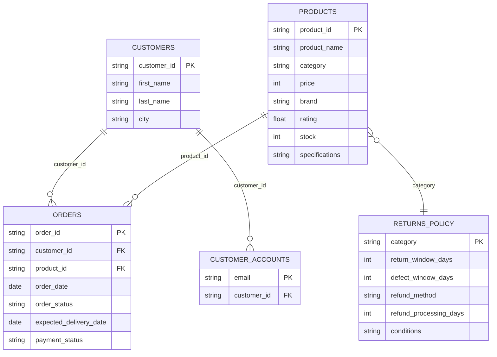

# Data tables and relationships

The project uses CSV files in this folder as its source of truth. They can be opened directly in Excel or another spreadsheet app. The dashboard shows all products in **Shop**, and shows only the signed-in customer's orders in **Orders**.

## Current tables

| File | Rows | Key and purpose |
|---|---:|---|
| `products.csv` | 300 | `product_id` identifies each product; `category` joins to return policies. Product identities are real India-market listings. |
| `product_research_sources.csv` | 24 | One checked retailer or brand listing source for each product category. |
| `orders.csv` | 300 | `order_id` identifies each order; `product_id` and `customer_id` join to products and customers. |
| `customers.csv` | 120 plus verified signups | Customer profiles keyed by `customer_id`; includes customers without orders. |
| `customer_accounts.csv` | Local-only; starts empty | Maps verified email addresses to customer IDs for sign-in. Copy `customer_accounts.example.csv` to this filename before running the web app. |
| `returns_policy.csv` | 24 | One synthetic policy row for each product category. |

## Keep the joins valid

- Every `orders.product_id` must exist in `products.product_id`.
- Every `orders.customer_id` and `customer_accounts.customer_id` must exist in `customers.customer_id`.
- Every product category must have exactly one row in `returns_policy.csv`.
- Keep IDs stable when editing rows; other files use them as references.
- Only add email addresses you control to `customer_accounts.csv`; this file is excluded from Git because it contains personal information.
- New accounts are added to both `customers.csv` and `customer_accounts.csv` only after the email OTP is verified.

Product names and brands are curated from India-market retailer or brand listings. Prices are indicative listing snapshots checked on 2026-11-03, not guaranteed or live offers; check the linked source before relying on a price. The specifications summarize listed model features. `product_research_sources.csv` records the category listing pages used. Product ratings and stock quantities remain synthetic demo values and should not be treated as current retailer reviews or availability. Orders and customer profiles are synthetic demonstration data, and return policies are demo policies. These CSVs are not backed by a live retailer database. Order data is the source for order facts; customer labels are display-only.
